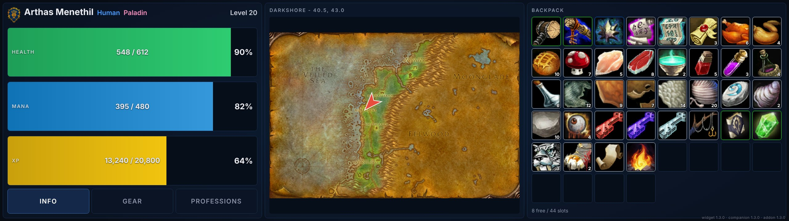
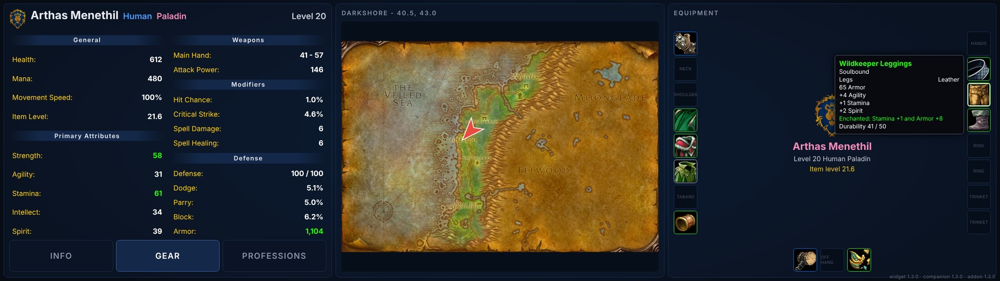
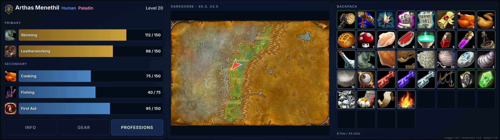

<p align="center">
  
</p>

<h1 align="center">WoWXE</h1>

<p align="center">
  <b>World of Warcraft Forever on your Corsair Xeneon Edge.</b><br>
  Health, mana, XP, the zone map, your backpack, gear, stats and professions on the 2560×720 touchscreen next to your monitor.
</p>

<p align="center">
  <a href="../../releases/latest">Download</a> ·
  <a href="#install">Install</a> ·
  <a href="#troubleshooting">Troubleshooting</a> ·
  <a href="#how-it-works">How it works</a>
</p>



| Gear (tap an item for its tooltip) | Professions |
| --- | --- |
|  |  |

When WoW isn't running, the screen shows a stand-by picture:


> Screenshots use a made-up character.

## Features

- **Character header:** faction crest, name, race (faction colour), class (class colour) and level.
- **Info tab:** health, mana (or rage/energy...) and XP bars with `current / max` and %. The XP bar disappears at max level.
  When the game hides exact numbers in combat, values are estimated from the bar fill.
- **Map:** the real zone map with your position and facing arrow, and `Zone - x, y` coordinates.
  Complete, fully explored maps are downloaded once per zone.
- **Backpack:** every bag slot with the item's icon, stack count and quality colour. **Tap an item to see the real in-game tooltip.**
- **Gear tab:** the character-window sheet (General, Primary Attributes, Weapons, Modifiers, Defense; buffed values in green).
  The backpack is replaced by your equipment, laid out like the character window, with tooltips.
- **Professions tab:** primary and secondary professions with icons and skill bars.
- **Stand-by screen** when WoW isn't running, and a small **!** button on the map for any messages.
- **Launcher** with Play (launches WoW through Battle.net), Start/Stop, automatic WoW folder and monitor detection,
  one-click addon install/update, and minimize to tray.
- **Display only.** WoWXE never sends input to the game and never reads game memory.

## Requirements

- Windows 10 or 11
- Corsair **Xeneon Edge** with **iCUE 5.47** or newer
- **World of Warcraft Forever**, running in **Windowed** or **Windowed (Fullscreen)** mode. Exclusive fullscreen can't be captured.
- An internet connection the first time you visit each zone (maps) and for a few item icons. After that it works offline.

## Install

1. Download **`WoWXE-vX.Y.Z.zip`** from the [latest release](../../releases/latest) and unzip it anywhere, for example `Documents\WoWXE`.
2. Run **`WoWXE.exe`**.
   - It finds your WoW folder (`...\World of Warcraft\_forever_`). If it doesn't, click **Browse...**.
   - It offers to **install the WoWXE addon**. Click **Yes**.
   - Click **Play** to launch WoW Forever, or **Start** if the game is already running.
3. In iCUE, import **`WoWXE.icuewidget`** (in the same folder) and add it to the Xeneon Edge at size **XL**.
4. In WoW, type `/reload` if it was already running when you installed the addon.

Windows SmartScreen may warn about an unknown publisher the first time you run `WoWXE.exe`, because the app isn't code-signed.
Click **More info → Run anyway**, or run it from source (below).

### Updating

Download the new release, unzip it over the old folder, run `WoWXE.exe` and accept the addon update, then re-import the widget in iCUE.
The bottom-right corner of the widget shows the version of each part (`widget · companion · addon`).
It turns amber if they don't match.

## Using it

- **Tabs:** Info, Gear and Professions at the bottom of the first column. The widget remembers the last one.
- **Tooltips:** tap any backpack or equipment slot; tap again (or anywhere else) to close.
  A new item's tooltip can take up to ~30 seconds to arrive the first time; after that it's cached.
- **Launcher:** **Play** starts the companion and launches WoW Forever through Battle.net.
  Minimizing hides it to the tray (Open / Start / Stop / Quit). Closing the window stops everything.
  With **Stop the companion when WoW closes** on, it also stops by itself shortly after you exit the game.
- **In game:** `/wowxe ver` shows the addon version. `/wowxe hide` and `/wowxe show` hide or show the strip.
  `/wowxe test` lists the values the game hides from addons.

## Troubleshooting

| What you see | What to do |
| --- | --- |
| Stand-by picture while playing | WoW must be Windowed or Windowed (Fullscreen); the addon must be enabled (character select → AddOns); press **Start** in the launcher. |
| Addon shows as "out of date" | Tick **Load out of date AddOns**, or add your game's interface number (`/dump (select(4, GetBuildInfo()))`) to `## Interface:` in `WoWXE.toc`. |
| `addon ?` in the bottom-right corner | Type `/reload` in game; the version arrives a few seconds later. |
| Amber version text | The parts are different versions: update the addon from the launcher and re-import the widget. |
| A map or icon is missing | Tap the **!** on the map to see why. Maps download once per zone; check your internet connection. |
| Taps do nothing | Re-import `WoWXE.icuewidget` (it must be the version that ships with this release). |
| Hiding the UI (Alt+Z) | Also hides the strip, so the widget shows stand-by until the UI is back. |

Turn on **Show log** in the launcher for details. It's the most useful thing to attach to an issue.

## How it works

```
 WoW + WoWXE addon ──draws a tiny coloured strip (top-left, a few pixels tall)──┐
                                                                                ▼
 WoWXE companion ── reads the strip from the screen (any monitor, any resolution/UI scale)
                 ── reads map/icon pictures from your local game files (read-only)
                 ── serves everything on http://127.0.0.1:8765 (your PC only)
                                                                                ▼
 iCUE widget on the Xeneon Edge ── polls the companion and draws the three columns
```

WoW addons can't write files or talk to other programs, so the addon encodes its data as coloured pixels.
The companion reads those pixels and also reads pictures straight from the game's files, so nothing flashes on your screen.

The addon only uses the normal addon API. The companion doesn't read game memory, inject anything or send keys or clicks.
That said, this is an unofficial tool: **use it at your own risk.**

## Run from source (Python)

```bat
git clone https://github.com/emanuelhborges/WoWXE.git
cd WoWXE
"Start WoWXE.bat"        :: installs mss, numpy, Pillow, pystray on first run, then opens the launcher
```

You need Python 3.10+ (with Tkinter, included in the python.org installer). Command-line use:

```
python companion/wowxe_companion.py --game-dir "C:\Games\World of Warcraft\_forever_" [--monitor auto|N] [--port 8765]
                                    [--no-web-icons] [--no-wiki-maps] [--casc-probe] [--version]
```

Tests (no WoW needed: the real addon runs against a stubbed WoW API): `pip install lupa numpy Pillow` then `python tests/test_pipeline.py`.
Every push runs them on Windows and builds `WoWXE.exe` ([workflow](.github/workflows/build.yml)).
Pushing a `vX.Y.Z` tag, or running the **Build** workflow with a version, publishes a release.

```
WoWXE.pyw, launcher_core.py   launcher (and WoWXE.exe)
addon/WoWXE/                  the WoW addon
companion/                    screen reader + game-file reader (casc.py) + local web server
widget/                       the iCUE widget (package with: npx icuewidget-cli package widget)
tests/                        end-to-end tests
```

## Credits

- Made by **maX**.
- Zone maps: [Warcraft Wiki](https://warcraft.wiki.gg), CC BY-SA 4.0, downloaded at runtime.
- Item icons missing from local files: [wago.tools](https://wago.tools), downloaded at runtime.
- World of Warcraft, the WoW Forever logo, faction crests, maps and icons are trademarks and artwork of
  **Blizzard Entertainment**. Xeneon Edge and iCUE are trademarks of **Corsair**.
  WoWXE is a fan project and isn't affiliated with or endorsed by Blizzard or Corsair.

## License

[PolyForm Noncommercial 1.0.0](LICENSE.md). You're free to use, change and share WoWXE for any **noncommercial** purpose.
Commercial use isn't allowed.
